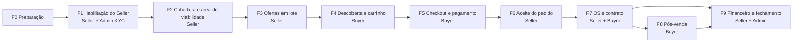

# Compra completa em lote

Plano para fechar uma compra de ponta a ponta no NeutraMais V6, em homologação, com Seller, Buyer e Admin. Cada fase é um fluxo, na ordem em que ele precisa acontecer. Cada tarefa diz o que o front já tem, o que falta fazer e como conferir.

- **Fonte única:** [plan.json](plan.json). As tabelas deste README são geradas dele por `node docs/e2e-purchase-flow/render.mjs`.
- **Acompanhamento:** status e motivos de cada tarefa ficam no painel do lote (link na seção [Registro do lote](#registro-do-lote)), não neste arquivo.
- **Fontes:** portal de documentação das APIs (conferência de 26/10/2026 e changelogs até 04/11/2026) e o front na branch `feature/neu-399`.

## O que é uma compra completa

**Serviço** (Conectividade, Infra física, Recursos numéricos, Softwares, Protocolos):

1. O Buyer paga o checkout e o pedido vai para `paid_in_escrow`.
2. O Seller aceita dentro do SLA de aceite.
3. A ordem de serviço nasce com `acknowledged`.
4. O Seller sobe o contrato na OS e o Buyer assina na Autentique.
5. O Seller inicia e conclui a OS (`completed`).
6. O recebível fica elegível ao repasse no Payment.

**Produto físico** (Hardware e CPE):

1. O Buyer paga.
2. O Seller aceita, anexa a NF e a etiqueta é comprada.
3. A entrega é feita e o Buyer confirma o recebimento.
4. O repasse é liberado 7 dias depois do recebimento.

## Ordem lógica

O lote começa pelo Seller. Sem ofertas publicadas em todas as categorias, o Buyer não tem o que comprar.

Ofertas sem KMZ (`requiresCoverage=false`) pulam a F2 e vão direto da F1 para a F3.

## Como rodar o lote

1. Copie os parâmetros para o registro do lote e preencha os valores (F0-01).
2. Rode a F0-03 e ajuste a matriz se a árvore de categorias mudou. Para isso, edite o `plan.json`, rode o `render.mjs` e republique o painel.
3. Execute as fases em ordem. Na F3, execute todos os casos `OF-*` e `NEG-*`. Da F4 à F9, siga cada trilha `CP-*` até o fim e depois as `ALT-*`.
4. Registre cada tarefa e cada caso no painel: `passou`, `falhou` ou `bloqueado`. Em `falhou`, `bloqueado` e `pendente` parado, o motivo é obrigatório: a mensagem de erro, o código (por exemplo `409 MKT_RULE_VALUES_REQUIRED`), o ID do pedido ou da oferta e o link da evidência.
5. Tarefa com V6 `Falta` fica `bloqueado` com a demanda D- como motivo até a demanda ser entregue.

## Registro do lote

Painel do lote: <https://claude.ai/artifact/JnDUKAryJhtszq9Dj8AgtK> (acesso pelo menu Compartilhar do painel; quem registra precisa ser Contribuidor).

No painel, cada pessoa da equipe marca status e motivo, e a última alteração mostra quem fez. Um lote novo (`RUN_ID` novo) começa com tudo pendente e mantém o histórico dos lotes anteriores.

<!-- plan:start -->

## Resumo

| Fase | Papéis | Tarefas | Pronto | Parcial | Falta | Backend | Validar |
| --- | --- | --- | --- | --- | --- | --- | --- |
| F0 · Preparação do lote | Admin, Seller, Buyer | 4 | 1 | 0 | 0 | 1 | 2 |
| F1 · Habilitação do Seller | Seller, Admin | 10 | 9 | 0 | 1 | 0 | 0 |
| F2 · Cobertura e área de viabilidade | Seller | 9 | 6 | 1 | 1 | 0 | 1 |
| F3 · Ofertas em lote | Seller | 12 | 9 | 1 | 1 | 0 | 1 |
| F4 · Descoberta e carrinho | Buyer | 8 | 2 | 2 | 4 | 0 | 0 |
| F5 · Checkout e pagamento | Buyer | 7 | 1 | 1 | 5 | 0 | 0 |
| F6 · Aceite do pedido | Seller | 6 | 0 | 2 | 2 | 0 | 2 |
| F7 · Ordem de serviço e contrato | Seller, Buyer | 9 | 1 | 1 | 7 | 0 | 0 |
| F8 · Pós-venda do Buyer | Buyer, Seller | 6 | 0 | 0 | 5 | 1 | 0 |
| F9 · Financeiro e fechamento | Seller, Admin | 7 | 1 | 1 | 3 | 1 | 1 |

Total: 78 tarefas, 36 casos de oferta e 19 trilhas de compra. No V6 hoje: 30 prontas, 9 parciais, 29 faltando, 3 dependendo do backend e 7 só de execução.

## Parâmetros do lote

Preencha antes de começar. Os valores reais (e-mails, arquivos, endereços) ficam no registro do lote, nunca no repositório. Senhas e tokens não entram em lugar nenhum.

| Chave | O que é | Exemplo | Observação |
| --- | --- | --- | --- |
| `RUN_ID` | Identificador do lote | L01 | Prefixo de tudo que o lote cria: E2E-{RUN_ID}-{caso}. |
| `API_BASE` | Ambiente das APIs | https://hom-api.neutramais.com | Homologação. |
| `FRONT_URL` | Front V6 | http://localhost:3000 | Front local apontando para homologação. |
| `SELLER_ORG` | Organização Seller | E2E Seller {RUN_ID} Ltda | CNPJ válido de teste. |
| `SELLER_OWNER` | Seller Dono (seller_owner) | e-mail da conta | MFA ativo. Faz onboarding Stripe. |
| `SELLER_COMMERCIAL` | Seller Comercial (seller_commercial) | e-mail da conta | Cria e publica ofertas. |
| `SELLER_OPERATIONS` | Seller Operações (seller_operations) | e-mail da conta | Só preço, estoque e SLA. |
| `SELLER_TECHNICAL` | Seller Técnico (seller_technical) | e-mail da conta | Executa a ordem de serviço. |
| `BUYER_ORG` | Organização Buyer | E2E Buyer {RUN_ID} Ltda | País BR e CNPJ ativo para ativação automática. |
| `BUYER_OWNER` | Buyer Dono (buyer_owner) | e-mail da conta | Configura alçada e aprova. |
| `BUYER_FINANCE` | Buyer Financeiro (buyer_finance) | e-mail da conta | Paga (payment:create). |
| `BUYER_PURCHASER` | Buyer Operações (buyer_purchaser) | e-mail da conta | Compra dentro da alçada. |
| `BUYER_TECHNICAL` | Buyer Técnico (buyer_technical) | e-mail da conta | Acompanha OS e tickets. |
| `ADMIN_COMPLIANCE` | Admin Compliance | e-mail da conta | kyc:approve com MFA. |
| `ADMIN_SUPER` | Admin super_admin | e-mail da conta | Categorias, selo, taxas e calendário. |
| `ADMIN_FINANCE` | Admin Financeiro (finance) | e-mail da conta | Conciliação e repasse. |
| `KMZ_POLYGONS` | KMZ com polígonos e placemarks | e2e-cobertura-poligonos.kmz | Até 50 MB. Pelo menos 3 áreas para recorte. |
| `KMZ_POINTS` | KMZ com pontos de rede | e2e-cobertura-pontos.kmz | CTO, POP e OLT como placemarks. |
| `KMZ_INVALID` | KMZ inválido | e2e-invalido.kmz | Arquivo corrompido para teste negativo. |
| `ADDRESS_IN` | Endereço dentro do recorte | endereço com CEP | Tem de cair dentro da área publicada. |
| `ADDRESS_IN_KMZ_OUT_CUT` | Endereço no KMZ e fora do recorte | endereço com CEP | Prova que o recorte vale. |
| `ADDRESS_OUT` | Endereço fora do KMZ | endereço com CEP | Não pode achar oferta de serviço. |
| `ORIGIN_POSTAL_CODE` | CEP de origem do físico | 01310-100 | Pacote de envio do Hardware. |
| `DEST_POSTAL_CODE` | CEP de entrega | 20040-020 | Cotação de frete. |
| `CARD_OK` | Cartão Stripe aprovado | 4242 4242 4242 4242 | Modo de teste. |
| `CARD_DECLINED` | Cartão Stripe recusado | 4000 0000 0000 0002 | Modo de teste. |
| `CARD_3DS` | Cartão Stripe com 3DS | 4000 0025 0000 3155 | Modo de teste. |
| `PURCHASER_LIMIT` | Teto por compra do buyer_purchaser | R$ 500,00 | Um caso abaixo e um acima. |
| `SLA_SHORT` | SLA de aceite curto | 1 hora | Para testar expiração do aceite. |

## Fases e tarefas

Coluna V6: situação do front hoje. Coluna Demanda: item da lista de demandas (D-) ou dependência de backend (B-) que destrava a tarefa.

### F0 · Preparação do lote

**Papéis:** Admin, Seller, Buyer. **Objetivo:** Deixar parâmetros, contas, arquivos e categorias prontos antes de criar qualquer oferta.

| ID | Papel | Tarefa | Tela V6 | Rotas | V6 | Demanda | Critério de aceite |
| --- | --- | --- | --- | --- | --- | --- | --- |
| F0-01 | QA | Preencher os parâmetros do lote (RUN_ID, contas, KMZ, endereços, cartões) | — | — | Validar | — | Todos os parâmetros obrigatórios preenchidos no registro do lote. |
| F0-02 | QA | Conferir /health das APIs do fluxo (Identity, Compliance, Marketplace, Geo, Orders, Payment, Wallet, Contracts, Service Ordering, Notification) | — | `GET /<api>/health` | Validar | — | Todas respondem 200 e o SHA bate com a develop. |
| F0-03 | Admin | Ler árvore de categorias e template de cada uma, e atualizar a matriz de ofertas | — | `GET /api/v2/productCatalog/category?tree=true` `GET /api/v2/productCatalog/category/{id}` | Pronto | D-09 | Matriz da F3 cobre toda categoria e subcategoria ativa, com os campos e regras do template vigente. O assistente lista a árvore da API. |
| F0-04 | QA | Confirmar que a entrega de eventos entre APIs está ligada (outbox de Orders, Payment, Contracts e Service Ordering) | — | — | Backend | B-01 | Um evento de teste sai do outbox e chega no destino sem ação manual. |

### F1 · Habilitação do Seller

**Papéis:** Seller, Admin. **Objetivo:** Seller com KYC verificado, conta Stripe ativa e equipe com os papéis certos.

| ID | Papel | Tarefa | Tela V6 | Rotas | V6 | Demanda | Critério de aceite |
| --- | --- | --- | --- | --- | --- | --- | --- |
| F1-01 | Seller | Cadastrar a organização Seller com telefone E.164 | `/register` | `POST /api/v1/organizations/register` | Pronto | — | Organização criada com status pending e kyc_level pending. |
| F1-02 | Seller | Confirmar e-mail (link de 15 min) e telefone | `/register/confirm-email` | `POST /api/v1/auth/confirm-email` `POST /api/v1/auth/confirm-phone` | Pronto | — | E-mail e telefone confirmados. Seller segue pending até o KYC. |
| F1-03 | Seller | Ativar MFA do Seller Dono | `/profile` | `POST /api/v1/users/me/mfa/enroll` `POST /api/v1/users/me/mfa/confirm` | Pronto | — | Token traz MFA. Rotas com MFA deixam de responder 403. |
| F1-04 | Seller | Enviar documentos de KYC e submeter para revisão | `/kyc` | `POST /api/v1/organizations/{org_id}/kyc/artifacts` `POST /api/v1/organizations/{org_id}/kyc/submit` | Pronto | — | Solicitação aparece na fila da Compliance. |
| F1-05 | Admin | Revisar e decidir o KYC (iniciar revisão, decidir documentos, decidir conta) | `/admin/kyc/[organizationId]` | `POST /api/v1/admin/kyc/requests/{id}/start-review` `POST /api/v1/admin/kyc/requests/{id}/documents/{doc}/decision` `POST /api/v1/admin/kyc/requests/{id}/decision` | Pronto | — | Identity grava kyc_level verified e status active. |
| F1-06 | Seller | Renovar o token e conferir kyc_level verified | `/dashboard` | `POST /api/v1/auth/refresh` `POST /api/v1/auth/context/refresh` | Pronto | — | Token novo com kyc_level verified. Telas de oferta liberam publicar. |
| F1-07 | Seller | Convidar a equipe (Comercial, Operações, Técnico) | `/profile` | `POST /api/v1/organizations/{org_id}/members` | Pronto | — | Cada usuário entra com o papel certo e vê só o que o papel permite. |
| F1-08 | Seller | Fazer onboarding Stripe Connect do Seller Dono | `/seller/wallet` | `POST /api/v2/payment/onboarding` `POST /api/v2/payment/onboarding/refresh` `GET /api/v2/payment/access/{organization_id}` | Pronto | D-10 | GET access diz conta ativa. Sem isso o Seller não recebe repasse. |
| F1-09 | Seller | Configurar SLA da organização e aceite automático da conta | `/seller/offers` | `PATCH /api/v2/productCatalog/slaConfig` `PUT /api/v2/productCatalog/productOffering/account/shippingPolicy` | Pronto | D-11 | Valores gravados e devolvidos no GET. Aceite automático muda o fluxo da F6. |
| F1-10 | Admin | Dar o selo de verificação ao Seller (opcional) | `/admin/organizations/[organizationId]` | `PUT /api/v2/productCatalog/verification/{organization_id}` | Falta | D-17 | Selo aparece na vitrine e no card do Seller. |

### F2 · Cobertura e área de viabilidade

**Papéis:** Seller. **Objetivo:** Subir os KMZ, ver os elementos e escolher a área de viabilidade que cada oferta vai usar.

| ID | Papel | Tarefa | Tela V6 | Rotas | V6 | Demanda | Critério de aceite |
| --- | --- | --- | --- | --- | --- | --- | --- |
| F2-01 | Seller | Pré-visualizar o consumo de armazenamento do KMZ | `/seller/coverage` | `POST /api/v2/geo/coverageVersion/kmz/preview` | Pronto | D-22 | Tela mostra o espaço que o arquivo vai ocupar antes do envio. |
| F2-02 | Seller | Enviar KMZ_POLYGONS e KMZ_POINTS | `/seller/coverage` | `POST /api/v2/geo/coverageVersion/kmz` | Pronto | — | Cada envio cria uma versão de cobertura imutável. |
| F2-03 | Seller | Abrir o arquivo, ver versões e pré-visualização | `/seller/coverage/[fileId]` | `GET /api/v2/geo/coverageFile` `GET /api/v2/geo/coverageFile/{id}/versions` `GET /api/v2/geo/coverageFile/{id}/preview` | Pronto | — | Mapa mostra os polígonos e pontos do KMZ. |
| F2-04 | Seller | Listar elementos do KMZ e escolher as áreas de viabilidade | `/seller/offers/new` | `GET /api/v2/geo/coverageVersion/{id}/elements` | Pronto | — | Índices das áreas escolhidas batem com os elementos do KMZ. |
| F2-05 | Seller | Desenhar polígono próprio dentro do KMZ | `/seller/offers/new` | — | Pronto | — | Polígono fica dentro dos polígonos do KMZ. Fora dele, erro claro. |
| F2-06 | Seller | Marcar pontos de rede com raio | `/seller/offers/new` | `POST /api/v2/geo/networkPoint` `POST /api/v2/geo/networkPoint/nearby` | Parcial | D-19 | Pontos com raio entre 1 e 100.000 m, centro dentro do KMZ. |
| F2-07 | Seller | Validar a classificação dos elementos (CTO, cabo, poste) | `/seller/coverage/[fileId]` | `GET /api/v2/geo/coverageVersion/{id}/classifications` `POST /api/v2/geo/coverageVersion/{id}/classifications/{index}/validation` | Falta | D-19 | Classificação revisada fica no histórico. |
| F2-08 | Seller | Arquivar e restaurar um arquivo, e conferir a cota | `/seller/coverage/[fileId]` | `POST /api/v2/geo/coverageFile/{id}/archive` `POST /api/v2/geo/coverageFile/{id}/restore` `GET /api/v2/geo/organizations/{id}/storage` | Pronto | — | Arquivo arquivado some da escolha de cobertura e volta ao restaurar. |
| F2-09 | Seller | Enviar KMZ_INVALID e um arquivo acima de 50 MB | `/seller/coverage` | `POST /api/v2/geo/coverageVersion/kmz` | Validar | — | Erro claro na tela. Nenhuma versão criada. |

### F3 · Ofertas em lote

**Papéis:** Seller. **Objetivo:** Criar e publicar uma oferta para cada caso da matriz: toda categoria, toda variante de cobertura e todo valor de cada opção.

| ID | Papel | Tarefa | Tela V6 | Rotas | V6 | Demanda | Critério de aceite |
| --- | --- | --- | --- | --- | --- | --- | --- |
| F3-01 | Seller | Criar a especificação com os valores do template da categoria | `/seller/offers/new` | `POST /api/v2/productCatalog/productSpecification` | Pronto | D-09 | API aceita characteristics sem MKT_TEMPLATE_FIELD_*. O assistente mostra subcategorias e os campos do template sem tela própria. |
| F3-02 | Seller | Criar a oferta em rascunho | `/seller/offers/new` | `POST /api/v2/productCatalog/productOffering` | Pronto | — | Oferta com status draft e coverageRequired igual ao da categoria. |
| F3-03 | Seller | Preencher as regras condicionais do template (ruleValues) | `/seller/offers/new` | `POST /api/v2/productCatalog/productOffering` `PATCH /api/v2/productCatalog/productOffering/{id}` | Pronto | D-08 | Oferta traz badges e ruleFields. Regra obrigatória vazia bloqueia publicar com 409 MKT_RULE_VALUES_REQUIRED. |
| F3-04 | Seller | Vincular a cobertura com a variante do caso (CV1 a CV5) | `/seller/offers/new` | `PUT /api/v2/productCatalog/productOffering/{id}/coverageVersion` | Pronto | — | Área pública (GET offerCoverage) igual ao recorte escolhido. |
| F3-05 | Seller | Enviar, confirmar e ordenar imagens | `/seller/offers/new` | `POST .../images` `POST .../images/{id}/confirm` `PUT .../images/order` | Pronto | — | Ordem das imagens na vitrine igual à definida. |
| F3-06 | Seller | Publicar a oferta | `/seller/offers/[offeringId]` | `POST /api/v2/productCatalog/productOffering/{id}/publish` | Pronto | — | Status published. Aparece na busca pública com os campos do template. |
| F3-07 | Seller | Editar preço, estoque e SLA com o papel Operações | `/seller/offers/[offeringId]/edit` | `PATCH /api/v2/productCatalog/productOffering/{id}` | Pronto | — | Operações altera só preço, estoque e SLA. Outros campos dão 403. |
| F3-08 | Seller | Gerenciar histórico de preços (adicionar, alterar, encerrar) | `/seller/offers/[offeringId]` | `POST .../price` `PATCH .../price/{id}` `DELETE .../price/{id}` | Pronto | D-20 | Preço vigente no snapshot de checkout é o último ativo. |
| F3-09 | Seller | Ciclo de vida: pausar, despublicar, arquivar, remover rascunho e destacar | `/seller/offers` | `POST .../pause` `POST .../unpublish` `POST .../archive` `DELETE .../{id}` `PUT .../promotion` | Pronto | — | Cada transição reflete na vitrine e na lista do Seller. |
| F3-10 | Seller | Importar ofertas por XLSX da categoria (caminho alternativo do lote) | `/seller/offers` | `GET /api/v2/productCatalog/productOffering/bulk/template` `POST /api/v2/productCatalog/productOffering/bulk` | Falta | D-21 | Resposta por linha (applied ou invalid). Tela não trata 200 como tudo gravado. |
| F3-11 | Seller | Executar todos os casos da matriz de ofertas | `/seller/offers/new` | — | Validar | — | Todo caso OF-* com resultado igual ao esperado. |
| F3-12 | Buyer | Conferir a vitrine pública de cada oferta publicada | `/offers` | `GET /api/v2/productCatalog/productOffering/search` `GET /api/v2/productCatalog/productOffering/public/{id}` `GET /api/v2/productCatalog/productOffering/featured` | Parcial | D-09 | Oferta aparece com categoria, selos e campos públicos. Vitrine de campanhas ainda usa dados de exemplo. |

### F4 · Descoberta e carrinho

**Papéis:** Buyer. **Objetivo:** Buyer ativo encontra as ofertas pela região, prova a viabilidade e monta o carrinho.

| ID | Papel | Tarefa | Tela V6 | Rotas | V6 | Demanda | Critério de aceite |
| --- | --- | --- | --- | --- | --- | --- | --- |
| F4-01 | Buyer | Cadastrar o Buyer, confirmar e-mail e telefone, ativar MFA | `/register` | `POST /api/v1/organizations/register` `POST /api/v1/auth/confirm-email` `POST /api/v1/auth/confirm-phone` | Pronto | — | Buyer BR com CNPJ ativo fica active sem revisão manual. |
| F4-02 | Buyer | Convidar Financeiro, Operações e Técnico | `/profile` | `POST /api/v1/organizations/{org_id}/members` | Pronto | — | Cada papel entra com as permissões do mapa da Identity. |
| F4-03 | Buyer | Configurar a alçada do buyer_purchaser | `/profile` | `GET /api/v2/wallet/spendingLimits` `PUT /api/v2/wallet/spendingLimits/{user_id}` | Falta | D-04 | GET spendingLimits/me do purchaser mostra o teto PURCHASER_LIMIT. |
| F4-04 | Buyer | Converter endereço em ponto | `/search-network` | `POST /api/v2/productCatalog/productOffering/resolveLocation` | Falta | D-01 | Endereço vira latitude e longitude. |
| F4-05 | Buyer | Buscar ofertas por localização com ADDRESS_IN, ADDRESS_IN_KMZ_OUT_CUT e ADDRESS_OUT | `/search-network` | `POST /api/v2/productCatalog/productOffering/searchByLocation` `GET /api/v2/productCatalog/operations/{operation_id}` | Falta | D-01 | ADDRESS_IN acha a oferta. Os outros dois não acham. Cada busca devolve searchEvidenceId. |
| F4-06 | Buyer | Ver detalhe público e área da oferta no mapa | `/offers` | `GET /api/v2/productCatalog/productOffering/public/{id}` `GET /api/v2/geo/offerCoverage/{offering_id}` | Parcial | D-01 | Mapa mostra o recorte público, não o KMZ inteiro. |
| F4-07 | Buyer | Validar condições de compra e cotar frete do físico | `/cart` | `POST .../productOffering/{id}/validatePurchase` `POST .../productOffering/{id}/shippingQuote` | Falta | D-11 | Cotação com prazo e valor para DEST_POSTAL_CODE. Oferta inválida bloqueia o carrinho. |
| F4-08 | Buyer | Montar carrinho com serviço (com evidência), sem cobertura e físico | `/cart` | `GET .../productOffering/{id}/checkoutSnapshot` | Parcial | D-02 | Snapshot schemaVersion=3 lido para cada item. Totais batem com preço e setup. |

### F5 · Checkout e pagamento

**Papéis:** Buyer. **Objetivo:** Transformar o carrinho em pedidos pagos, com alçada e pagamento Stripe em modo de teste.

| ID | Papel | Tarefa | Tela V6 | Rotas | V6 | Demanda | Critério de aceite |
| --- | --- | --- | --- | --- | --- | --- | --- |
| F5-01 | Buyer | Criar o checkout com MFA e Idempotency-Key | `/cart` | `POST /api/v2/productOrder/checkout` `GET /api/v2/productOrder/operations/checkout` | Falta | D-02 | Um pedido por Seller e por lugar, todos awaitingPayment. |
| F5-02 | Buyer | Acompanhar o progresso do checkout | `/cart` | `GET /api/v2/productOrder/checkout/{id}/progress` `GET /api/v2/productOrder/checkout/{id}` | Falta | D-02 | Tela de espera mostra a etapa e termina no resultado. |
| F5-03 | Buyer | Compra do purchaser acima da alçada: aprovar e recusar | `/orders` | `GET /api/v2/productOrder/checkoutApprovals` `POST .../checkout/{id}/approval` `POST .../checkout/{id}/rejection` `GET .../checkout/{id}/approval` | Falta | D-04 | Checkout fica awaitingApproval. Aprovação volta para awaitingPayment. Recusa cancela sem cobrança. |
| F5-04 | Buyer | Autorizar o pagamento (reserva na Wallet) | `/cart` | `POST /api/v2/productOrder/checkout/{id}/fundingAuthorization` | Falta | D-03 | Saldo reservado aparece em GET wallet/balance. Comando assinado devolvido. |
| F5-05 | Buyer | Pagar com CARD_OK, com parte do saldo da Wallet | `/cart` | `POST /api/v2/payment` `GET /api/v2/payment/checkout/{checkoutId}/progress` | Falta | D-03 | Webhook do Stripe confirma. Pedidos vão para paid_in_escrow com acceptanceDeadline. |
| F5-06 | Buyer | Listar pedidos do Buyer e abrir o detalhe com o pagamento | `/orders/[orderId]` | `GET /api/v2/productOrder/buyer` `GET /api/v2/productOrder/{id}` `GET /api/v2/payment/order/{order_id}` | Parcial | D-12 | Lista mostra todos os pedidos do lote. Detalhe mostra Wallet, cartão e retenção. |
| F5-07 | Buyer | Conferir extrato da Wallet do Buyer | `/wallet/transactions` | `GET /api/v2/wallet/transactions` | Pronto | — | Débito do checkout aparece com o valor usado do saldo. |

### F6 · Aceite do pedido

**Papéis:** Seller. **Objetivo:** Seller decide cada pedido pago dentro do SLA de aceite.

| ID | Papel | Tarefa | Tela V6 | Rotas | V6 | Demanda | Critério de aceite |
| --- | --- | --- | --- | --- | --- | --- | --- |
| F6-01 | Seller | Ver pedidos pagos com o prazo de aceite | `/seller/orders` | `GET /api/v2/productOrder/seller` | Parcial | D-05 | Pedido paid_in_escrow mostra o prazo acceptanceDeadline. |
| F6-02 | Seller | Aceitar pedido de serviço | `/seller/orders/[orderId]` | `POST /api/v2/productOrder/{order_id}/accept` | Falta | D-05 | Pedido accepted. Orders publica o evento que gera a OS. |
| F6-03 | Seller | Recusar pedido com motivo | `/seller/orders/[orderId]` | `POST /api/v2/productOrder/{order_id}/reject` | Falta | D-05 | Pedido rejected. Buyer recebe crédito Neutra na Wallet. |
| F6-04 | Seller | Aceitar pedido físico, anexar NF e imprimir etiqueta | `/seller/orders/[orderId]` | `POST .../{order_id}/shipping/accept` `POST .../{order_id}/shipping/invoice` `GET .../shipping/labels/{label_id}.pdf` | Parcial | — | NF anexada libera a compra da etiqueta. PDF da etiqueta abre. |
| F6-05 | Seller | Venda automática: pedido entra aceito | `/seller/orders` | — | Validar | — | Com aceite automático, pedido vai direto para accepted sem ação do Seller. |
| F6-06 | Seller | Deixar o prazo SLA_SHORT expirar | `/seller/orders` | — | Validar | — | Pedido expired. Buyer recebe crédito Neutra. |

### F7 · Ordem de serviço e contrato

**Papéis:** Seller, Buyer. **Objetivo:** Depois do pagamento e do aceite, a OS nasce. O Seller sobe o contrato, o Buyer assina e o Seller executa até concluir.

| ID | Papel | Tarefa | Tela V6 | Rotas | V6 | Demanda | Critério de aceite |
| --- | --- | --- | --- | --- | --- | --- | --- |
| F7-01 | Seller | Ver a OS criada após o aceite (acknowledged) | `/seller/service-orders` | `GET /api/v2/serviceOrder/seller` `GET /api/v2/serviceOrder/{id}` | Falta | D-06 | OS do pedido aparece com status acknowledged. Hoje a tela usa dados de exemplo. |
| F7-02 | Seller | Subir o contrato da OS para assinatura | `/seller/service-orders/[orderId]` | `rota a confirmar com o backend` | Falta | D-07 | Contrato do pedido criado e visível para o Buyer. |
| F7-03 | Buyer | Assinar o contrato pela Autentique (sandbox) | `/contracts/[contractId]` | `GET /api/v2/order-contracts?orderId=` `POST /api/v2/order-contracts/{id}/sign` | Parcial | D-07 | Link pessoal abre a Autentique. Webhook marca a assinatura. |
| F7-04 | Buyer | Conferir contrato assinado e baixar o PDF | `/contracts/[contractId]` | `GET /api/v2/order-contracts/{id}` `GET /api/v2/order-contracts/{id}/document` | Pronto | — | Status assinado, hash do documento e signatários corretos. |
| F7-05 | Seller | Iniciar a execução | `/seller/service-orders/[orderId]` | `POST /api/v2/serviceOrder/{id}/start` | Falta | D-06 | OS inProgress com startedAt. |
| F7-06 | Seller | Registrar andamento com observação e percentual | `/seller/service-orders/[orderId]` | `PATCH /api/v2/serviceOrder/{id}/note` | Falta | D-06 | Observação e percentual visíveis para o Buyer. |
| F7-07 | Seller | Concluir a execução | `/seller/service-orders/[orderId]` | `POST /api/v2/serviceOrder/{id}/complete` | Falta | D-06 | OS completed com completionReference. Recebível fica elegível no Payment. |
| F7-08 | Buyer | Acompanhar a OS pelo lado do Buyer | `/orders/[orderId]` | `GET /api/v2/serviceOrder/buyer` | Falta | D-06 | Buyer Dono e Técnico veem a OS. Financeiro e Operações recebem 403. |
| F7-09 | Seller | Trocar mensagens na sala do pedido (opcional) | `/seller/service-orders/[orderId]` | `POST /api/v2/communication/rooms` `GET /ws/orders/{order_id}/chat` | Falta | D-16 | Mensagens chegam nas duas pontas. |

### F8 · Pós-venda do Buyer

**Papéis:** Buyer, Seller. **Objetivo:** Recebimento, avaliação, suporte e cancelamentos depois da compra.

| ID | Papel | Tarefa | Tela V6 | Rotas | V6 | Demanda | Critério de aceite |
| --- | --- | --- | --- | --- | --- | --- | --- |
| F8-01 | Buyer | Confirmar ou contestar o recebimento do físico | `/orders/[orderId]` | `POST .../{order_id}/shipping/received` `POST .../{order_id}/shipping/contest` | Falta | D-13 | Confirmação libera o repasse após 7 dias. Contestação bloqueia. |
| F8-02 | Buyer | Dar o aceite técnico do serviço | `/orders/[orderId]` | — | Backend | B-04 | Planejado na RN. Sem rota hoje. |
| F8-03 | Buyer | Avaliar o Seller e conferir a reputação | `/orders/[orderId]` | `POST /api/v2/productCatalog/review` `GET /api/v2/productCatalog/review/order/{order_id}` `GET /api/v2/productCatalog/reputation/{organization_id}` | Falta | D-15 | Avaliação gravada e refletida na reputação. |
| F8-04 | Buyer | Abrir ticket, Seller reconhece e resolve, Buyer fecha | `/tickets` | `POST /api/v2/troubleTicket` `POST .../{id}/acknowledge` `POST .../{id}/resolve` `POST .../{id}/close` | Falta | D-14 | Ticket passa pelos quatro estados. Hoje a tela usa dados de exemplo. |
| F8-05 | Buyer | Cancelar pedido antes da execução | `/orders/[orderId]` | `POST /api/v2/productOrder/{order_id}/cancel` | Falta | D-18 | Pedido cancelado, crédito Neutra na Wallet, payment.funding.compensated. |
| F8-06 | Buyer | Pedir cancelamento com execução iniciada e Seller decidir | `/orders/[orderId]` | `POST .../{order_id}/cancellationRequests` `POST .../cancellationRequests/{id}/decision` | Falta | D-18 | Aprovação cancela. Recusa mantém o pedido. |

### F9 · Financeiro e fechamento

**Papéis:** Seller, Admin. **Objetivo:** Fechar o dinheiro da compra: recebível, repasse, antecipação e conciliação.

| ID | Papel | Tarefa | Tela V6 | Rotas | V6 | Demanda | Critério de aceite |
| --- | --- | --- | --- | --- | --- | --- | --- |
| F9-01 | Seller | Ver o recebível do pedido concluído | `/seller/wallet` | `GET /api/v2/payment/seller/receivables` | Pronto | — | Recebível do pedido aparece elegível ao repasse. |
| F9-02 | Seller | Simular e confirmar antecipação e saque | `/seller/wallet/withdraw` | `POST /api/v2/payment/seller/advances/quote` `POST /api/v2/payment/seller/advances` `POST /api/v2/payment/seller/withdrawals/quote` `POST /api/v2/payment/seller/withdrawals` | Parcial | D-23 | Simulação mostra bruto, taxa e líquido. Confirmação envia para a conta Stripe. |
| F9-03 | Admin | Rodar o repasse do mês (operador) | — | `processo de repasse do Payment (linha de comando)` | Backend | B-07 | Lote de repasse criado e transferido pelo Stripe Connect. |
| F9-04 | Seller | Conferir o lote de repasse | `/seller/wallet` | `GET /api/v2/payment/seller/payouts` `GET /api/v2/payment/seller/payouts/{id}` | Falta | D-23 | Lote traz o pedido do lote com descontos. |
| F9-05 | Admin | Conciliar pagamentos, repasses, saques e créditos de cancelamento | `/admin` | `GET /api/v2/payment/operations/payouts` `GET /api/v2/payment/operations/cashouts` `GET /api/v2/wallet/operations/cancellationCredits` | Falta | D-17 | Valores do lote batem entre Payment, Wallet e Orders. |
| F9-06 | Admin | Ajustar calendário de repasse e taxas de antecipação | `/admin` | `PATCH /api/v2/payment/payoutSchedule` `PUT /api/v2/payment/operations/cashoutRates/{organization_id}` | Falta | D-17 | Nova versão vale a partir de effectiveFrom. |
| F9-07 | QA | Fechar o lote: conferir a compra completa de cada trilha CP-* | — | — | Validar | — | Toda trilha CP-* passou do checkout ao recebível. |

## Matriz de ofertas (F3)

Cada valor de cada opção aparece em pelo menos uma oferta. Cada categoria ativa tem pelo menos uma oferta publicada. Categoria com requiresCoverage=true passa por todas as variantes de cobertura. Atualize a lista com GET /category?tree=true antes do lote (F0-03).

### Dimensões

| Dimensão | Valores |
| --- | --- |
| Cobertura | CV1 KMZ inteiro, CV2 áreas do KMZ (coverageAreaIndexes), CV3 polígono desenhado (publicGeometry), CV4 pontos de rede com raio (coverageNetworkPoints), CV5 áreas mais pontos, SEM sem KMZ (requiresCoverage=false) |
| Modelo de preço | monthly, annual, oneTime |
| Moeda | BRL, USD |
| Taxa de instalação | zero, maior que zero |
| SLA de aceite (horas) | 1, 24, 72 |
| Imagens | 0, 1, 3 com reordenação |
| Velocidade | Mbps, Gbps |
| Unidade vendida (Infra física) | port, fiber, rack_unit, square_meter, meter, unit |
| Condição (Hardware) | new, used, refurbished |
| Serializado (Hardware) | yes, no |
| Frete (Hardware) | integration, freeShipping, pickup, cargo, toBeAgreed |
| Tempo para postagem (Hardware) | sameDay, oneDay, twoDays, threeDays, onDemand |
| Tipo de recurso (Recursos numéricos) | ipv4, ipv6, asn, e164 |
| Registro (Recursos numéricos) | lacnic, nic_br, arin, ripe, apnic, afrinic, anatel |
| Atributo adicional | text, number, mbps, gbps, ms, percent |
| Regras do template | sem regra, regra preenchida, regra obrigatória vazia |

### Casos

| ID | Categoria | Cobertura | Opções | Esperado | Depende de |
| --- | --- | --- | --- | --- | --- |
| OF-CON-01 | Conectividade | CV1 | monthly, BRL, 500 Mbps, setup zero, SLA 72, 0 imagens | Publica. Área pública igual ao KMZ inteiro. | — |
| OF-CON-02 | Conectividade | CV2 | annual, BRL, 1 Gbps, setup maior que zero, SLA 24, 3 imagens reordenadas | Publica. Área pública só com as áreas escolhidas. | — |
| OF-CON-03 | Conectividade | CV3 | oneTime, USD, localidades A e Z, IPs incluídos | Publica. Área pública igual ao polígono. | — |
| OF-CON-04 | Conectividade | CV4 | monthly, BRL, SLA 1 (SLA_SHORT) | Publica. Usada no teste de expiração do aceite. | — |
| OF-CON-05 | Conectividade | CV5 | monthly, BRL, aceite automático ligado | Publica. Pedido entra accepted direto. | — |
| OF-CON-06 | Subcategoria de Conectividade (ex.: Link dedicado) | CV2 | campos herdados mais campos próprios | Publica com os campos da subcategoria. | D-09 |
| OF-INF-01 | Infra física | CV1 | soldUnit port, monthly | Publica. | — |
| OF-INF-02 | Infra física | CV2 | soldUnit fiber, annual | Publica. | — |
| OF-INF-03 | Infra física | CV3 | soldUnit rack_unit, oneTime | Publica. | — |
| OF-INF-04 | Infra física | CV4 | soldUnit square_meter, monthly, USD | Publica. | — |
| OF-INF-05 | Infra física | CV5 | soldUnit meter, monthly | Publica. | — |
| OF-INF-06 | Infra física | CV1 | soldUnit unit, annual, atributos text e number | Publica com os atributos. | — |
| OF-HW-01 | Hardware e CPE | SEM | new, serializado, integration, sameDay, estoque 10 | Publica como physical. | — |
| OF-HW-02 | Hardware e CPE | SEM | used, não serializado, freeShipping, oneDay | Publica. | — |
| OF-HW-03 | Hardware e CPE | SEM | refurbished, pickup com endereço e horário, twoDays | Publica. | — |
| OF-HW-04 | Hardware e CPE | SEM | new, cargo com preço e prazo, threeDays | Publica. | — |
| OF-HW-05 | Hardware e CPE | SEM | new, toBeAgreed, onDemand 10 dias | Publica. Compra depende da RFQ (B-03). | — |
| OF-NUM-01 | Recursos numéricos | SEM | ipv4, lacnic, estoque 1 | Publica. | — |
| OF-NUM-02 | Recursos numéricos | SEM | ipv6, nic_br | Publica. | — |
| OF-NUM-03 | Recursos numéricos | SEM | asn, arin | Publica. | — |
| OF-NUM-04 | Recursos numéricos | SEM | e164, anatel | Publica. | — |
| OF-NUM-05 | Recursos numéricos | SEM | ipv4, ripe | Publica. | — |
| OF-NUM-06 | Recursos numéricos | SEM | ipv6, apnic | Publica. | — |
| OF-NUM-07 | Recursos numéricos | SEM | asn, afrinic | Publica. | — |
| OF-SW-01 | Softwares e gerenciamento | SEM | monthly, BRL | Publica sem KMZ. | — |
| OF-SW-02 | Softwares e gerenciamento | SEM | annual, USD, atributos percent e ms | Publica com os atributos. | — |
| OF-PRO-01 | Protocolos e serviços | SEM | oneTime, BRL, atributos mbps e gbps | Publica sem KMZ. | — |
| OF-PRO-02 | Protocolos e serviços | SEM | monthly, BRL, setup maior que zero | Publica. | — |
| OF-RULE-01 | Toda categoria com templateRules | conforme categoria | regra preenchida | Oferta traz badges e ruleFields. Snapshot v3 traz checkoutEffects. | D-08, D-17 |
| OF-RULE-02 | Toda categoria com templateRules | conforme categoria | regra obrigatória vazia | Publicar dá 409 MKT_RULE_VALUES_REQUIRED. | D-08, D-17 |
| NEG-01 | Conectividade | CV1 | SLA de aceite 73 | 422 na criação ou edição. | — |
| NEG-02 | Conectividade | sem vínculo | publicar sem cobertura | 409. Oferta continua draft. | — |
| NEG-03 | Conectividade | CV3 | polígono fora do KMZ | Erro de geometria. Vínculo não gravado. | — |
| NEG-04 | Conectividade | CV2 mais CV3 | coverageAreaIndexes junto com publicGeometry | 422. | — |
| NEG-05 | Hardware e CPE | SEM | sem estoque | Publicar recusado (hasNumericStock). | — |
| NEG-06 | Qualquer | qualquer | Seller sem kyc_level verified | Publicar recusado. | — |

## Trilhas de compra (F4 a F9)

CP- são compras que precisam fechar. ALT- são caminhos alternativos e negativos.

| ID | Trilha | Oferta | Quem compra | Caminho | Esperado | Depende de |
| --- | --- | --- | --- | --- | --- | --- |
| CP-01 | Serviço com cobertura recortada | OF-CON-02 | `BUYER_FINANCE` | ADDRESS_IN, CARD_OK, Seller aceita, OS, contrato, executa, conclui | Recebível elegível. Pedido fechado. | D-01, D-02, D-03, D-05, D-06, D-07, B-02 |
| CP-02 | Serviço sem cobertura | OF-SW-01 | `BUYER_FINANCE` | CARD_OK, Seller aceita, OS, contrato, executa, conclui | Recebível elegível. | D-02, D-03, D-05, D-06, D-07, B-02 |
| CP-03 | Recurso numérico com estoque | OF-NUM-01 | `BUYER_OWNER` | CARD_OK, Seller aceita, OS, contrato, conclui | Recebível elegível. Conferir baixa de estoque (D-26 da documentação). | D-02, D-03, D-05, D-06, D-07, B-02 |
| CP-04 | Físico com frete integrado | OF-HW-01 | `BUYER_FINANCE` | shippingQuote, CARD_OK, aceite físico, NF, etiqueta, entrega, recebimento | Repasse liberado após recebimento mais 7 dias. | D-02, D-03, D-11, D-13 |
| CP-05 | Físico com retirada | OF-HW-03 | `BUYER_OWNER` | CARD_OK, aceite físico, NF, retirada, recebimento | Recebimento com receivedSource pickup. | D-02, D-03, D-13 |
| CP-06 | Carrinho com dois lugares | OF-CON-01 e OF-INF-02 | `BUYER_FINANCE` | dois endereços dentro da cobertura, um checkout | Um pedido por Seller e por lugar. | D-01, D-02, D-03 |
| CP-07 | Compra dentro da alçada | OF-PRO-02 | `BUYER_PURCHASER` | valor abaixo de PURCHASER_LIMIT | Checkout segue sem aprovação. | D-02, D-03, D-04 |
| CP-08 | Compra acima da alçada aprovada | OF-CON-03 | `BUYER_PURCHASER` | valor acima de PURCHASER_LIMIT, Dono aprova, Financeiro paga | awaitingApproval, depois awaitingPayment, depois paid_in_escrow. | D-02, D-03, D-04 |
| ALT-01 | Cartão recusado | OF-SW-02 | `BUYER_FINANCE` | CARD_DECLINED | Pedido segue awaitingPayment. Reserva da Wallet liberada. | D-02, D-03 |
| ALT-02 | Cartão com 3DS | OF-SW-02 | `BUYER_FINANCE` | CARD_3DS | Desafio 3DS concluído e pedido pago. | D-02, D-03 |
| ALT-03 | Seller recusa | OF-INF-01 | `BUYER_FINANCE` | CARD_OK, Seller recusa com motivo | rejected e crédito Neutra ao Buyer. | D-02, D-03, D-05 |
| ALT-04 | Prazo de aceite expira | OF-CON-04 | `BUYER_FINANCE` | CARD_OK, esperar SLA_SHORT | expired e crédito Neutra ao Buyer. | D-02, D-03 |
| ALT-05 | Venda automática | OF-CON-05 | `BUYER_FINANCE` | CARD_OK | accepted sem ação do Seller. | D-02, D-03, D-11 |
| ALT-06 | Alçada recusada | OF-CON-03 | `BUYER_PURCHASER` | acima do teto, Financeiro recusa | Checkout cancelled. Nada cobrado. | D-02, D-04 |
| ALT-07 | Cancelamento antes da execução | OF-PRO-01 | `BUYER_OWNER` | pago e aceito, Buyer cancela | Crédito Neutra e payment.funding.compensated. | D-02, D-03, D-05, D-18 |
| ALT-08 | Cancelamento com execução iniciada | OF-INF-03 | `BUYER_OWNER` | OS inProgress, Buyer pede, Seller decide | Cancelamento direto recusado. Pedido de cancelamento segue a decisão. | D-02, D-03, D-05, D-06, D-18 |
| ALT-09 | Busca sem oferta na região | nenhuma | `BUYER_OWNER` | ADDRESS_OUT | Nenhuma oferta de serviço. RFQ não existe (B-03). | D-01, B-03 |
| ALT-10 | Checkout repetido com a mesma Idempotency-Key | OF-SW-01 | `BUYER_FINANCE` | reenviar o POST | Mesmo checkout. Nenhum pedido duplicado. | D-02 |
| ALT-11 | Oferta pausada depois de ir ao carrinho | OF-PRO-02 | `BUYER_FINANCE` | Seller pausa, Buyer faz checkout | Checkout recusa o item com motivo claro. | D-02 |

## Demandas de front

| ID | Demanda | Papéis | Escopo | Tarefas |
| --- | --- | --- | --- | --- |
| D-01 | Busca por endereço com prova de viabilidade | Buyer | Proxies e tela para resolveLocation, searchByLocation (X-Operation-ID e progresso) e evidência. Mapa da área pública da oferta. | F4-04, F4-05, F4-06 |
| D-02 | Checkout real | Buyer | Trocar o aviso 'em breve' do carrinho por POST checkout com MFA e Idempotency-Key, tela de progresso e recuperação pela chave. | F4-08, F5-01, F5-02 |
| D-03 | Pagamento do checkout | Buyer | fundingAuthorization, POST /payment com clientSecret no Stripe Elements, uso do saldo da Wallet e progresso do pagamento. | F5-04, F5-05 |
| D-04 | Alçada de compra | Buyer | Configurar spendingLimits por usuário. Lista de checkouts aguardando aprovação, aprovar e recusar. | F4-03, F5-03 |
| D-05 | Aceite e recusa do pedido de serviço | Seller | Botões de aceitar e recusar com motivo, prazo acceptanceDeadline visível na lista e no detalhe. | F6-01, F6-02, F6-03 |
| D-06 | Ordens de serviço reais | Seller, Buyer | Trocar o SellerServiceOrdersContext de exemplo pela Service Ordering API: listar, ler, iniciar, andamento e concluir. Visão do Buyer. | F7-01, F7-05, F7-06, F7-07, F7-08 |
| D-07 | Contrato na OS | Seller, Buyer | Seller sobe o contrato na OS. Buyer assina pela Autentique. Status e PDF ligados à OS. Depende da rota de upload (B-02). | F7-02, F7-03 |
| D-08 | Regras condicionais do template | Seller | Feito no assistente (PR #15 para a dev): seção Regras da categoria (obrigatória sempre ligada, opcional com interruptor), validação de todos os campos de valor, ruleValues no POST e PATCH (o BFF passou a repassar), reabertura na edição, selos no detalhe da oferta e mensagens para 409 MKT_RULE_VALUES_REQUIRED e 422 MKT_RULE_*. Em homologação nenhuma categoria tem regra: o teste OF-RULE-* depende de um super_admin criar uma (sem tela no V6, ver D-17). | F3-03 |
| D-09 | Categorias vindas da API | Seller, Buyer | Feito no assistente do Seller (PR #15 para a dev): árvore e template da API, subcategorias, categoria nova (família custom), flags requiresCoverage e hasNumericStock da API e campos genéricos do template. Falta a vitrine pública filtrar por subcategoria (F3-12). Rótulos, opções e unidades do template traduzidos em pt, en e es. | F0-03, F3-01, F3-12 |
| D-10 | Onboarding Stripe do Seller | Seller | Feito na Carteira do Seller (branch feature/e2e-seller-demands, depois do PR #15): card Conta de recebimento com a situação (GET access), Ativar/Continuar no Stripe (POST onboarding, abre o formulário) e Atualizar status (POST onboarding/refresh, também sozinho uma vez ao voltar do Stripe). Só o Dono configura. 403 mfa_required abre o step-up do MFA (POST /api/auth/mfa/step-up, reutilizável no checkout) e repete a ação. | F1-08 |
| D-11 | Configurações de venda e validações do carrinho | Seller, Buyer | Parte do Seller feita (branch feature/e2e-seller-demands, depois do PR #15): aba Configurações de venda em Minhas Ofertas, com os prazos de SLA (GET/PATCH slaConfig, só leitura sem sla:change) e o aceite automático dos físicos (GET/PUT account/shippingPolicy com expectedVersion; 409 relê). Falta a parte do Buyer: validatePurchase e shippingQuote no carrinho (F4-07). | F1-09, F4-07 |
| D-12 | Pedidos do Buyer | Buyer | Lista de pedidos do Buyer e detalhe com o pagamento do pedido. | F5-06 |
| D-13 | Recebimento do físico | Buyer | Confirmar e contestar recebimento. | F8-01 |
| D-14 | Tickets reais | Buyer, Seller | Trocar os tickets de exemplo pela Trouble Ticket API: abrir, notas, reconhecer, resolver, fechar e cancelar. | F8-04 |
| D-15 | Avaliação e reputação | Buyer | Avaliar o Seller pelo pedido e mostrar a reputação no card e na página do Seller. | F8-03 |
| D-16 | Chat do pedido | Buyer, Seller | Sala do pedido, mensagens e WebSocket. | F7-09 |
| D-17 | Telas de Admin do marketplace e do financeiro | Admin | Categorias, templates e catálogos (super_admin), selo de verificação, raio de proximidade, conciliação de pagamentos, repasses, saques e créditos, calendário e taxas. | F1-10, F9-05, F9-06 |
| D-18 | Cancelamento de pedido | Buyer, Seller | Cancelar direto, pedir cancelamento e decisão do Seller. | F8-05, F8-06 |
| D-19 | Pontos de rede e classificação do KMZ | Seller | CRUD de networkPoint e revisão da classificação dos elementos. | F2-06, F2-07 |
| D-20 | Histórico de preços da oferta | Seller | Feito no detalhe da oferta (branch feature/e2e-seller-demands, depois do PR #15): seção Preços com os ativos por tipo e faixa, histórico a pedido, adicionar faixa, alterar valor e encerrar com confirmação (price:change). Recusas MKT_PRICE_TIER_OVERLAP, MKT_OFFER_CURRENCY_MISMATCH, MKT_PRICE_INVALID e MKT_OFFER_PRICE_REQUIRED com mensagem própria. | F3-08 |
| D-21 | Importação XLSX de ofertas | Seller | Baixar modelo por categoria, enviar e mostrar o resultado por linha. | F3-10 |
| D-22 | Pré-visualização do consumo do KMZ | Seller | Feito (branch feature/e2e-seller-demands, depois do PR #15): as três telas de envio de KMZ (cobertura, nova versão e área de cobertura da oferta) chamam kmz/preview antes e pedem confirmação com tamanho, espaço da importação, uso, cota e saldo depois. Sem espaço, o envio fica travado. | F2-01 |
| D-23 | Antecipação, saque e repasses do Seller | Seller | Ligar a tela de saque às rotas de quote e confirmação, e listar os lotes de repasse. | F9-02, F9-04 |

## Dependências de backend

| ID | Item | Impacto | Situação |
| --- | --- | --- | --- |
| B-01 | Entrega de eventos entre APIs | Sem o envio do outbox, pagamento, aceite, contrato e OS não avançam sozinhos. | Informado como tratado. Validar em F0-04. |
| B-02 | Rota para o Seller subir o contrato na OS | O portal só documenta listar, ler, baixar e assinar (Buyer). Sem a rota, F7-02 fica bloqueada. | Backend criando a rota (informado em 05/11/2026). |
| B-03 | RFQ sem rotas de negócio | Frete a combinar e busca sem oferta não fecham compra. | Planejado. |
| B-04 | Aceite técnico do Buyer | RN prevê 72 horas úteis. Sem rota. | Planejado. |
| B-05 | Orders não recebe serviceOrder.completed | Pedido pode não ir para concluído mesmo com a OS concluída. | Conferir em CP-01. |
| B-06 | Notificações de pedido | Nenhuma API chama a Notification para pedido pago, aceito ou falha. | Planejado. |
| B-07 | Repasse por operador | Repasse roda por linha de comando. | Combinar janela com o backend para F9-03. |
| B-08 | Ordem entre contrato e OS | A documentação diz que contract.signed gera a OS. O fluxo combinado é OS primeiro e contrato depois, subido pelo Seller. | Fluxo confirmado em 05/11/2026: OS primeiro, contrato subido pelo Seller na OS. |

<!-- plan:end -->

## Como atualizar

1. Edite [plan.json](plan.json): fases, tarefas, casos, demandas ou dependências.
2. Rode `node docs/e2e-purchase-flow/render.mjs` para refazer as tabelas.
3. Republique o painel do lote com o `plan.json` novo. Os status já registrados ficam, porque são guardados pelo ID da tarefa.
